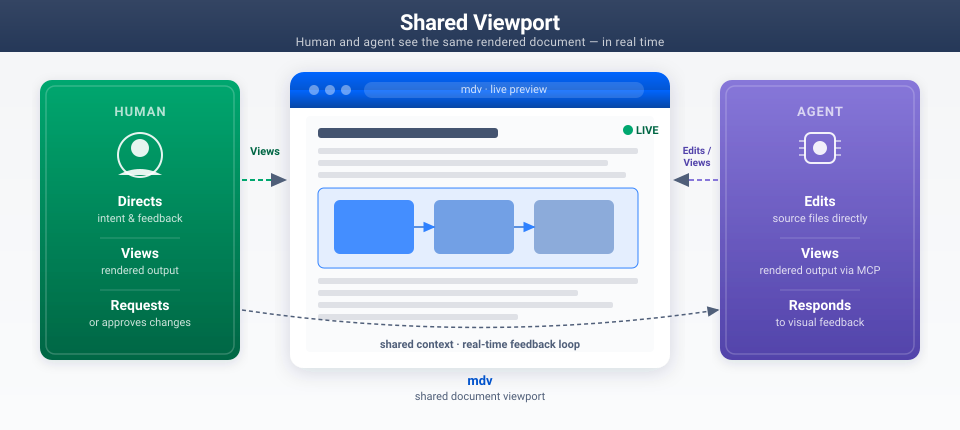
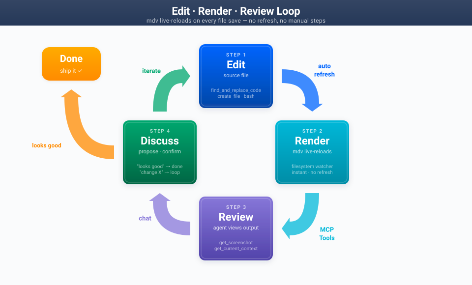

# mdv — Collaborative Document Viewport

A shared rendering environment for human and agent co-editing of markdown documents, diagrams, and visual content.



---

## What It Is

When your AI agent edits a markdown file, it can't see the result. It changes text and hopes it looks right. Tables might be unbalanced, diagrams might overflow, headings might be orphaned — but the agent has no idea.

**mdv fixes that.** It gives you and your agent a shared window into the same rendered document — live. The agent edits, mdv renders instantly, the agent sees what you see, and you iterate together on what's actually on screen.

---

## The Loop



**Edit** source files with normal tools. mdv **renders** instantly — no refresh, no manual steps. The agent **reviews** the rendered output via screenshot. You **discuss** what you see and decide: done, or iterate.

---

## What You Can Build

Anything where seeing the output matters — mdv makes the agent visually aware.

| Content type | What the agent sees |
|---|---|
| Architecture docs | Agent sees diagram proportions, label sizing, whitespace balance |
| Design documents | Real heading hierarchy, table layout, section flow |
| SVG diagrams | Pixel-accurate render at embed scale before you publish |
| Mermaid / D2 | Rendered graph output, not raw code |
| Tables | Column balance, row density, readability at a glance |
| Long-form docs | Scroll-aware context — agent knows what you're looking at |

### Working with diagrams

mdv and the **diagrams skill** work together as a pair:

- **Diagrams skill** owns SVG generation: type selection, design system, construction, validation
- **mdv** owns placement, visual verification, and iteration with you

When you ask for a new diagram, the agent loads the diagrams skill to generate it, then returns to mdv to place it in the document and verify it renders correctly at embed scale. You don't need to manage this handoff — it happens transparently.

Diagram formats supported: **SVG** (inline or referenced), **Mermaid**, **D2**.

---

## How It Works

The agent follows your lead. It won't add ceremony where it doesn't help — no screenshots after every line edit, no unsolicited mdv suggestions once you've declined.

The agent is assisting your judgment, not replacing it. *"I've made the diagram taller — does that look better?"* Not: *"The optimal aspect ratio is 16:9."*

### Entry points

You can jump in anywhere. There's no required starting state.

**Starting fresh:** "I need to build a design doc for X." Agent creates the file, suggests opening in mdv, builds structure, adds diagrams as needed, polishes, hands off.

**Mid-stream:** "Help me with this section." Agent orients in two tool calls, addresses the ask, verifies if there's a visual change. No preamble.

**Diagram first:** "I need a diagram showing the federation lifecycle." Agent loads diagrams skill, generates SVG, places it in the doc, verifies in mdv, iterates with you.

**Polish pass:** "Something feels off about the layout." Agent takes a screenshot, identifies specific issues (orphaned headings, unbalanced tables, diagrams too small), fixes section by section, checks the whole doc again.

**Handoff:** "It's ready — let's publish." Agent follows the Confluence skill workflow for publishing.

---

## Example Prompts

Copy-paste any of these to trigger the mdv skill:

- "Let's work on this doc"
- "Can you see what I'm looking at?"
- "Help me polish this"
- "The diagram looks off — can you fix it?"
- "Let's build a design doc for X"
- "It's ready — let's publish to Confluence"

**Not triggered by:**
- Pure code editing requests ("fix this bug")
- Simple README text changes
- Requests where visual rendering doesn't matter

---

## Installation

**1. Install mdv** (see the mdv project's own docs for platform-specific instructions)

**2. Wire the MCP server** in your agent config:

```json
{
  "mcpServers": {
    "mdv": {
      "command": "mdv",
      "args": ["mcp"]
    }
  }
}
```

**3. Register the skill:**

```bash
# From the rd-skills repo root:
./install.sh
# Select "mdv" from the interactive menu

# Or manually:
ln -sf "$(pwd)/skills/mdv" ~/.rovodev/skills/mdv
```

---

## Known Limitations

- **SVG diagrams in Confluence:** SVGs published via most Confluence MCP tools become file attachments, not inline SVGs. They render via Confluence's attachment preview. This is a tooling limitation, not an mdv issue.
- **Single active workspace:** If you have multiple agent sessions open simultaneously, they share the same mdv viewport. Concurrent editing from two agents will conflict. Best practice: one active agent session per mdv instance.

---

## Related

- [`SKILL.md`](SKILL.md) — Agent-facing skill documentation
- [Diagrams skill](../diagrams/) — SVG generation, design system, layout patterns
- [mdv](https://bitbucket.org/atlassian/mdv/src/main/) — The mdv application and MCP server (internal Atlassian repo — link kept for reference, not publicly accessible)
- [rd-skills](../../README.md) — Skills registry and installer

---

### Changelog

#### v1.0.0
- Initial release with collaboration model, MCP tool reference, agent behavior principles, workflow scenarios, Confluence handoff guidance, diagrams skill integration
- Showcase diagrams: `collaboration-model.svg`, `workflow-loop.svg`
